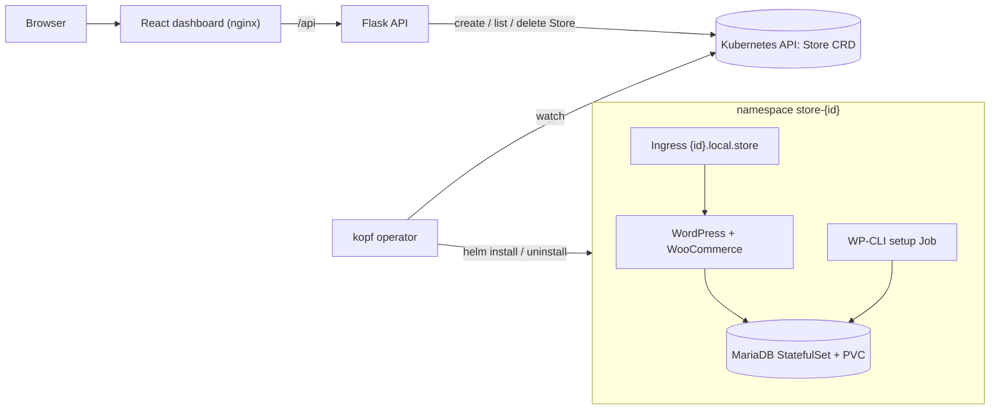

# Kubernetes Store Provisioning Platform

A self-service platform that provisions isolated WooCommerce stores on Kubernetes on demand, for anyone who wants one-click store environments without hand-writing manifests.

## Overview

Spinning up a WordPress + WooCommerce store by hand means creating a database, secrets, storage, an ingress and running the WooCommerce installer. This project turns that into one API call. A Flask API writes a `Store` custom resource, a Python operator built on kopf watches those resources and installs a per-store Helm chart, and a React dashboard shows each store moving through its lifecycle. Every store gets its own namespace with network policies, resource quotas and generated credentials, and deleting the resource tears it all down.

## Highlights

- **Custom resource + operator:** a `Store` CRD with a status subresource, reconciled by a kopf operator with create, delete, resume (after restart) and startup handlers (`controller/controller.py`).
- **Lifecycle phases:** each store moves `Provisioning -> Installing -> Configuring -> Ready` (or `Failed`), with timeouts of 300 s for `helm install`, 600 s for the WordPress Deployment and 300 s for the setup Job.
- **Per-store isolation:** namespace `store-<id>`, NetworkPolicies that only allow ingress-nginx to WordPress and WordPress or the setup Job to MariaDB, a ResourceQuota (4 pods, 2 CPU / 3Gi limits, 5Gi storage) and a LimitRange (`store-chart/`).
- **Idempotent secrets:** database and admin passwords are generated with `randAlphaNum 16` and preserved across upgrades via Helm `lookup`.
- **Automated store setup:** a WP-CLI Job installs WordPress and WooCommerce, sets the currency to USD, enables Cash on Delivery and creates a sample product.

## Architecture



The API is stateless: all state lives in the `Store` resources. The store chart is baked into the operator image at `/charts/store-chart`, so the operator runs `helm` without external dependencies. More design notes are in [docs/system-design.md](docs/system-design.md).

## Tech stack

Python 3.11 (Flask, flask-limiter, kopf, kubernetes_asyncio), React 18 + Vite, nginx, Helm 3, kind (local), k3s values for a VPS, WordPress 6.4, MariaDB 10.11.

## Quickstart (local, kind)

Requires Docker, kind, kubectl and Helm. Host ports 80 and 443 must be free.

```bash
./setup-cluster.sh        # kind cluster, ingress-nginx, builds 3 images, helm install with values-local.yaml
sudo bash add-hosts.sh    # maps dashboard.local.store and api.local.store to 127.0.0.1
```

Open http://dashboard.local.store and create a store, or use the API:

```bash
curl http://api.local.store/api/health
curl -X POST http://api.local.store/api/stores \
  -H "Content-Type: application/json" \
  -d '{"displayName": "Demo Shop", "storeType": "woocommerce"}'
kubectl get stores -n store-platform
kubectl logs -n store-platform deploy/store-platform-controller -f
```

Each store is served at `http://<store-id>.local.store`. Add that host to `/etc/hosts` or set up wildcard DNS for `*.local.store`. The WordPress admin password is stored in a secret:

```bash
kubectl get secret -n store-<store-id> store-<store-id>-wordpress \
  -o jsonpath='{.data.admin-password}' | base64 -d
```

Remove everything with `./teardown.sh`. For a VPS, `platform-chart/values-prod.yaml` holds k3s settings with placeholder domain and registry values to fill in.

### API

| Method | Path | Purpose |
|---|---|---|
| GET | `/api/health` | Health check |
| GET | `/api/stores` | List stores, newest first |
| GET | `/api/stores/<id>` | Get one store |
| POST | `/api/stores` | Create a store (`displayName` 1 to 50 chars, `storeType`) |
| DELETE | `/api/stores/<id>` | Delete a store; the operator cleans up |

Store IDs are a slug of the display name plus 6 random hex characters, capped at 20 characters. Requests are rate limited and the total number of stores is capped (10 in `values-local.yaml`).

## Project structure

```
backend/          Flask API (app.py, config.py, Dockerfile)
controller/       kopf operator (controller.py, Dockerfile with helm + kubectl)
frontend/         React dashboard, served by nginx which proxies /api
platform-chart/   Helm chart: CRD, RBAC, API, dashboard, operator, ingress
store-chart/      Helm chart for one store: WordPress, MariaDB, setup Job, policies
setup-cluster.sh  One-command local setup on kind
teardown.sh       Removes the platform, stores and the kind cluster
docs/             System design notes
```

## Limitations and next steps

- No authentication: anyone who can reach the API can create or delete stores, and the store cap is global rather than per user.
- Only WooCommerce is implemented. `medusa` is accepted by the CRD schema but rejected by the API.
- Store URLs need wildcard DNS or manual hosts entries, and TLS is off by default.
- No automated tests or CI yet. Next: add them, plus per-user quotas and cert-manager for TLS.

## License

No license specified yet.
